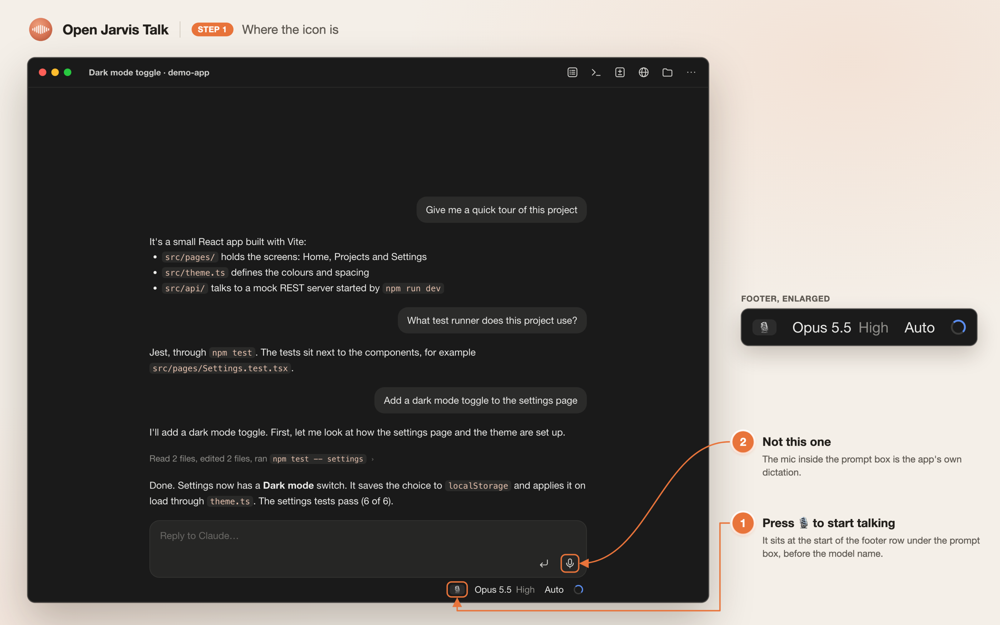
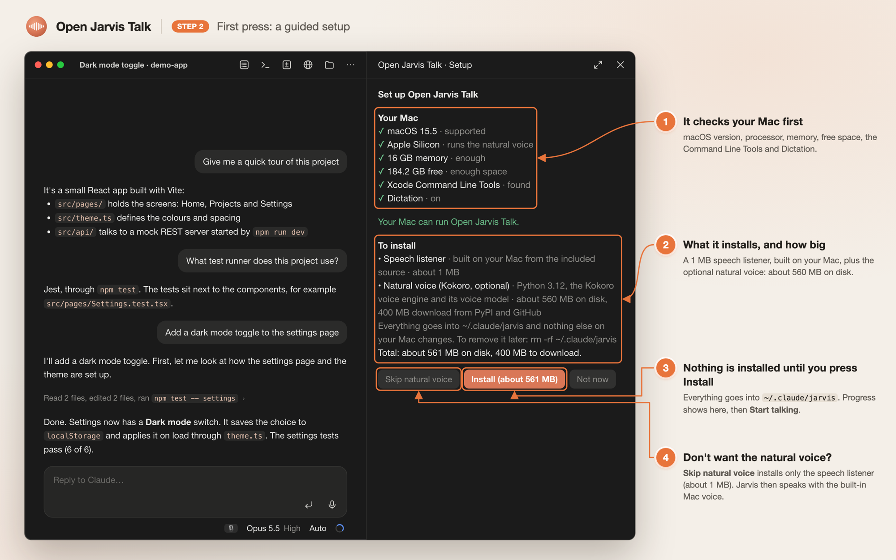
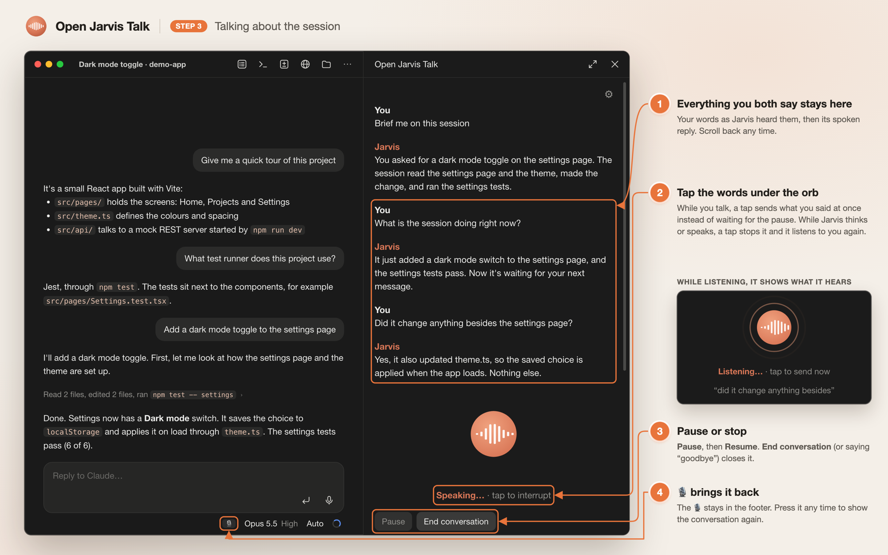
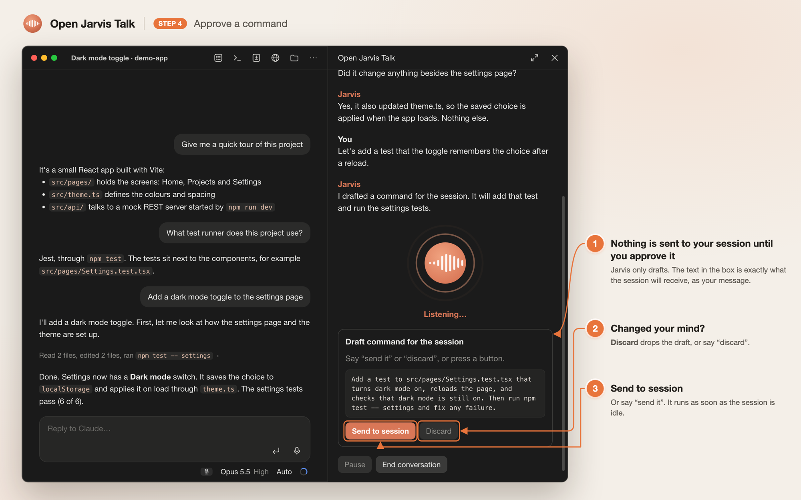
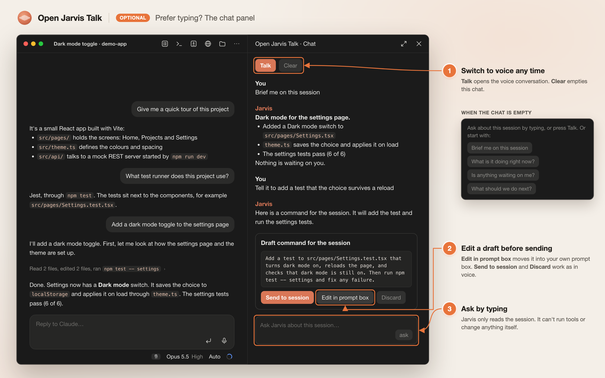
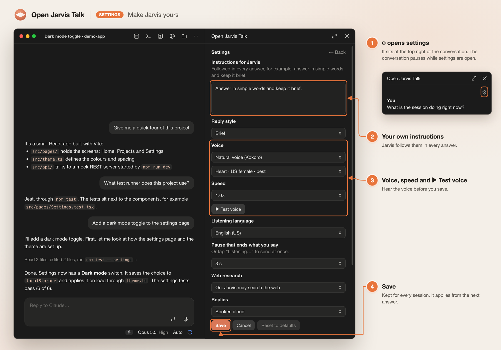

# Open Jarvis Talk

*A voice companion for Claude Code.*

Talk to your Claude Code session out loud. Press the 🎙️ at the start of the footer under the message box and a conversation panel opens. Ask what the session is doing, why, or what to do next, and Open Jarvis Talk answers in a natural voice. When you say something like "let's add tests", it drafts a message for the session. Nothing reaches the session until you approve it, by saying "send it" or pressing **Send to session**.

- **Knows the session.** It reads the conversation you're in, so it can answer questions about it.
- **Hands-free.** It listens, answers, and listens again. A pause doesn't cut you off. Say "goodbye", or press **End conversation**, to stop.
- **Natural voice, on your Mac.** Replies are spoken by [Kokoro](https://github.com/thewh1teagle/kokoro-onnx), a text-to-speech model that runs locally. If it isn't installed, the built-in Mac voice is used.
- **On-device speech recognition.** It uses macOS speech recognition.
- **Web research when needed.** For questions that need the web, it runs a separate `claude -p` search and answers from what it finds.
- **You approve every command.** Drafts appear on screen with **Send to session** and **Discard** buttons.
- **Make it yours.** Press **⚙** to give Jarvis your own instructions, pick its voice and speed, and more.

## How it looks

These are illustrations of the Claude desktop app. The plugin's parts (the 🎙️, the panel, the orb, the buttons and their wording) are drawn from its code; the conversation shown is an example.

**1. Press 🎙️ to start.** It sits at the start of the footer under the message box.



**2. The first press sets it up.** It checks your Mac, shows what it will install and how big it is, and installs nothing until you press **Install**.



**3. Talk about the session.** Tap the words under the orb to send what you said at once, or to interrupt Jarvis.



**4. Approve what it sends.** Jarvis drafts the message; nothing reaches the session until you approve it.



**5. Or type.** `/open-jarvis-talk-chat` opens a typed side chat about the session.



**6. Settings.** Your own instructions, reply style, voice and speed with a test button, listening language and more.



## Requirements

- macOS 13 or later.
- Claude Code: the desktop app or the terminal.
- Dictation turned on, in System Settings > Keyboard > Dictation. macOS speech recognition needs it.
- The first setup needs the Xcode Command Line Tools to build the small speech listener. Setup offers to install them.
- The natural voice needs an Apple Silicon Mac with 8 GB of memory and about 600 MB of disk space. On other Macs, the built-in Mac voice is used.

## Install

Open Jarvis Talk isn't in the Claude plugin directory yet, so you install it from its own marketplace, this repository. Add the marketplace first, then install the plugin from it.

At the prompt of a terminal Claude Code session:

```
/plugin marketplace add omegasoft7/open-jarvis-talk
```

```
/plugin install open-jarvis-talk@open-jarvis-talk
```

Choose a scope when asked. Use the user scope to have it in every session.

From a shell:

```bash
claude plugin marketplace add omegasoft7/open-jarvis-talk
```

```bash
claude plugin install open-jarvis-talk@open-jarvis-talk
```

In `open-jarvis-talk@open-jarvis-talk`, the first part is the plugin and the second is this marketplace. Typing only `/plugin install open-jarvis-talk` searches the marketplaces you already have, which can find a different plugin.

In the Claude desktop app, where `/plugin` doesn't run:
1. Click **+** next to the prompt box, then **Plugins**.
2. Click **Add marketplace** and enter `omegasoft7/open-jarvis-talk`.
3. Pick **Open Jarvis Talk** from that marketplace and click **Add plugin**.

Restart Claude Code after installing so the plugin loads.

## First use: guided setup

The first time you press 🎙️, a setup screen opens. Nothing is installed until you press **Install**. The screen:

1. **Checks your Mac:** macOS version, processor, memory, free space, the Xcode Command Line Tools, and Dictation.
2. **Lists what it will install, and how big each part is:**

   | Part | Size | Source |
   | --- | --- | --- |
   | Speech listener | about 1 MB | Built on your Mac from [`voice/listen.swift`](voice/listen.swift) |
   | Natural voice (optional) | about 560 MB on disk, about 400 MB download | Python 3.12, the Kokoro voice engine and its voice model, from PyPI and GitHub; downloads are checked against pinned checksums |
   | uv (only if you don't have it) | about 45 MB | [uv](https://github.com/astral-sh/uv) 0.12.18 from PyPI, installed by pip with pinned hashes ([`setup/uv-requirements.txt`](setup/uv-requirements.txt)) |

   Press **Skip natural voice** to install only the speech listener, about 1 MB.
3. **Installs on Install.** Progress shows on the setup screen. When it finishes, press **Start talking**.

Everything is installed into `~/.claude/jarvis`. Nothing else on your Mac changes. The first time you talk, macOS asks you to allow the microphone and speech recognition.

You can also run the setup from a terminal:

```bash
setup/jarvis-setup.sh check
setup/jarvis-setup.sh install              # add --no-voice to skip the natural voice
```

## Using it

- **🎙️ at the start of the footer under the message box** starts a conversation. While one is running, it shows that conversation again.
- **⚙ at the top of the conversation** opens the [settings](#settings).
- **Tap the words under the orb** ("Listening…", "Thinking…", "Speaking…"):
  - While you talk, a tap sends what you said right away, without waiting for the pause.
  - While Jarvis thinks or speaks, a tap stops it, and it listens to you again.
- **Pause** stops listening, and **Resume** starts again. **End conversation** closes the screen.
- Saying **"send it"** sends the drafted command, and **"discard"** drops it. Saying **"goodbye"** or **"stop"** ends the conversation.
- The whole conversation stays on the screen, so you can scroll back through it.
- `/open-jarvis-talk` starts a conversation. `/open-jarvis-talk-chat` opens a typed side chat about the session.

## Settings

Press **⚙** at the top of the conversation to open the settings. A running conversation pauses while they are open, and continues when you leave them. Press **Save** to keep your changes. They apply from the next answer and stay for every session.

| Setting | What it does | Default |
|---|---|---|
| Instructions for Jarvis | Your own instructions, followed in every answer. For example: "answer in simple words and keep it brief". Up to 2,000 characters. | none |
| Reply style | Brief, Normal, Detailed, or Simple words. | Brief |
| Voice | The natural voice (Kokoro) or the built-in Mac voice. For the natural voice, choose one of 28 English voices; Heart and Bella sound best. | Natural, Heart |
| Speed | From 0.8× to 1.5×. | 1.0× |
| ▶ Test voice | Plays a short sample in the voice and speed you chose. | |
| Listening language | The language Apple's speech recognition listens for. | English (US) |
| Pause that ends what you say | How long a silence sends what you said. You can also tap "Listening…" to send it at once. | 3 s |
| Web research | Whether Jarvis may search the web to answer. | On |
| Replies | Spoken aloud, or text only. | Spoken aloud |

Settings are saved in Claude Code's own storage for this plugin. **Reset to defaults** puts every setting back.

## What it runs, reads and sends

This is the full list, for users and reviewers.

**What it sends, and where**

- **Your questions, to Claude.** When you ask something, the plugin sends your question and the conversation so far to Claude. It uses your own Claude Code session's model call, the same way the session itself talks to Claude. Claude also sees the session's transcript, so it can answer about the session. Nothing else is sent.
- **Research questions, to Claude with web search.** When Claude asks for web research, the plugin runs your own `claude` command line tool (`claude -p`). Only web search and web fetch are allowed, and file editing and shell tools are blocked. The question goes in, and the findings come back.
- **Commands you approve, into the session.** A drafted command is submitted to the session as your message only when you press **Send to session** or say "send it". What's submitted is exactly the draft text shown on screen.
- **Nothing is uploaded during setup.** Setup only downloads, and only after you press **Install**:
  - uv 0.12.18, from PyPI, installed by the Mac's own Python and pip with the pinned hashes in [`setup/uv-requirements.txt`](setup/uv-requirements.txt)
  - Python 3.12 and the Python packages in [`voice/requirements.txt`](voice/requirements.txt), installed by uv from PyPI
  - the voice model, from `github.com/thewh1teagle/kokoro-onnx`

  uv is checked by pip against fixed SHA-256 hashes, the voice model downloads are checked against fixed SHA-256 checksums, and the Python packages are pinned to exact versions. The voice model files are data: nothing downloaded with `curl` is ever run.
- **Audio stays on your Mac.** Your voice is turned into text by macOS speech recognition, which runs on your Mac when it can. The spoken replies are made on your Mac.

**What it reads**

- The current session's conversation, so Claude can answer about it.
- Its own files in `~/.claude/jarvis`: the voice setting, the listener, the voice engine and its logs.
- Nothing else. It reads no passwords, keys or tokens. Research uses your own `claude` tool with your own Claude login, the same as when you run it yourself.

**Programs it starts, and why**

| Program | Why |
| --- | --- |
| `~/.claude/jarvis/jarvis-listen` | Listens to the microphone and prints what you said as text. Built at setup from [`voice/listen.swift`](voice/listen.swift). |
| `~/.claude/jarvis/kokoro/bin/python ~/.claude/jarvis/speak.py` | Speaks Jarvis's replies in the natural voice. The script is [`voice/speak.py`](voice/speak.py). |
| `/usr/bin/say` | Speaks replies in the built-in Mac voice if the natural voice isn't installed or fails. |
| `/bin/kill` | Stops the listener or the voice at once when you tap to send now or to interrupt, or press **Pause** or **End conversation**. |
| `/bin/bash setup/jarvis-setup.sh check`, `install`, `tools` and `dictation` | Setup: checks the Mac, installs on **Install**, opens Apple's Command Line Tools installer, or opens the Dictation settings. |
| `/bin/zsh -c` with short fixed scripts | Starts the listener and voices so each prints its process id first, and adds a line to `~/.claude/jarvis/jarvis.log`. The scripts are the `LISTEN`, `KOKORO` and `SAY` constants and the `jlog` function in [`hooks/register.tsx`](hooks/register.tsx). |
| `claude -p`, started through a login shell so it can be found | Web research, as described above. |

**Hooks**

- `command.run` answers only the plugin's own two commands, `/open-jarvis-talk` and `/open-jarvis-talk-chat`.
- `ui.close` reacts only when one of its own two panes closes: it stops listening and speaking.
- `ui.render` draws the 🎙️ in the footer under the message box and the plugin's own panes. The mode labels that footer already shows are kept as they were.
- `session.start` resets the conversation state and registers the two commands.

## Remove

1. Uninstall the plugin:
   ```bash
   claude plugin uninstall open-jarvis-talk
   ```
2. Delete the voice files:
   ```bash
   rm -rf ~/.claude/jarvis
   ```

## Troubleshooting

Logs are in `~/.claude/jarvis/`:
- `jarvis.log` records what it did, including why it switched to the Mac voice.
- `listen.log` comes from the speech listener.
- `setup.log` and `build.log` come from setup.

Common problems:
- **"macOS Dictation is turned off"**: turn it on in System Settings > Keyboard > Dictation, then press **Resume**.
- **Listening stops at once**: check that Claude is allowed to use the microphone, in System Settings > Privacy & Security > Microphone.
- **Research fails**: run `claude` in a terminal once, and sign in if it asks.

## Development

```bash
claude plugin validate .
claude plugin test .
```

The plugin is a Claude Code hooks module:
- [`hooks/register.tsx`](hooks/register.tsx) is the mod.
- [`voice/`](voice) holds the listener and voice programs.
- [`setup/jarvis-setup.sh`](setup/jarvis-setup.sh) is the installer.

## License

MIT, see [LICENSE](LICENSE). The natural voice uses kokoro-onnx (MIT) and the Kokoro-82M model (Apache 2.0), downloaded from their authors at setup and not part of this repository. Open Jarvis Talk is an independent project. It is not affiliated with Anthropic, or with the OpenJarvis project (open-jarvis/openjarvis), and does not use its code.
